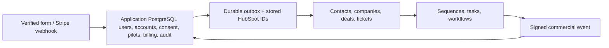

# HubSpot CRM Migration Guide

This document outlines the HubSpot workspace configuration that aligns with the existing Portals leads CRM module, replacing Apollo as the CRM system.

## Overview

The HubSpot configuration mirrors the Apollo data model with HubSpot-specific field mappings and object types. The application database remains the system of record, with HubSpot serving as a one-way sales projection.

## Architecture



## HubSpot Object Mappings

### Contacts
Corresponds to Apollo contacts. Contains individual lead information, assessment responses, and qualification data.

**Custom Fields (aligned with Apollo):**
- Identity: `preferred_asset_format`, `team_role`, `asset_contribution_count`, `approval_authority`
- Qualification: `qualification_score`, `qualification_tier`, `qualification_state`, `fit_score`, `pain_score`, `intent_score`
- Assessment: All diagnostic fields from `assessment-definition.ts`
- Attribution: `lead_intent`, `cta_label`, `source_page`, `utm_*` fields
- Consent: `marketing_consent`, `analytics_consent`

### Companies
Corresponds to Apollo accounts. Contains company-level data and scores.

**Custom Fields (aligned with Apollo):**
- New HubSpot-specific fields: `asset_usage_policy`, `preferred_creative_tool`, `number_of_locations`
- Shared qualification fields: `qualification_tier`, `qualification_state`, `fit_score`, `pain_score`, `intent_score`

### Deals
Corresponds to Apollo opportunities/deals. Tracks pilot requests and sales pipeline.

**Custom Fields (aligned with Apollo):**
- New HubSpot-specific fields: `asset_reuse_percentage_target`, `asset_type_requested`, `deadline_for_delivery`, `number_of_assets_required`
- Deal contact roles: `deal_contact_roles` (JSON array of contact roles)
- Submission tracking: `portals_submission_id`

### Tickets
New HubSpot object for support and issue tracking.

**Custom Fields:**
- `asset_version_issue`: Description of the version issue
- `urgency_level`: Critical, high, medium, low
- `asset_affected`: Which asset is affected
- `resolution_type`: Manual fix, workflow update, training, documentation, other

## HubSpot-Specific Custom Fields

### Contact Fields
- **preferred_asset_format**: Asset format preference (image, video, 3d_model, animation, audio, mixed_media, other)
- **team_role**: Team role (maps to workflow_role options)
- **asset_contribution_count**: Number of assets contributed
- **approval_authority**: Approval authority level

### Company Fields
- **asset_usage_policy**: How assets can be used (internal_only, client_delivery, portfolio_use, public_use, commercial_reuse, other)
- **preferred_creative_tool**: Primary creative tools used
- **number_of_locations**: Number of office/production locations

### Deal Fields
- **asset_reuse_percentage_target**: Target percentage for asset reuse
- **asset_type_requested**: Type of assets requested
- **deadline_for_delivery**: Delivery deadline
- **number_of_assets_required**: Total number of assets needed

## Configuration Files

### 1. `frontend/config/hubspot-lead-operations.json`
Declarative configuration of HubSpot custom fields, pipelines, and object types. This mirrors the Apollo config structure with HubSpot-specific adaptations.

**Key differences from Apollo:**
- Object types: `contacts`, `companies`, `deals`, `tickets` (vs Apollo's `contact`, `account`, `opportunity`)
- Field types: HubSpot uses `single_line_text`, `multiple_line_text`, `number`, `booleancheckbox`, `select`, `multi_select`, `date`
- Pipelines: HubSpot pipelines are more structured with stages and metadata
- Property groups: HubSpot organizes fields into groups for UI organization

### 2. `frontend/scripts/provision-hubspot.ts`
Provisioning script that creates HubSpot custom fields, property groups, and pipelines based on the configuration.

**Usage:**
```bash
# Set HUBSPOT_API_KEY in frontend/.env.local
HUBSPOT_API_KEY=your-private-app-api-key

# Run provisioning
npm --workspace frontend run provision:hubspot
```

**What it does:**
- Creates property groups: `portals_lead_qualification`, `portals_pilot_management`, `portals_assessment`
- Creates custom fields for contacts, companies, deals, and tickets
- Creates pipelines: lifecycle (contacts/companies), sales_pipeline (deals), support_pipeline (tickets)
- Verifies all fields exist after creation

### 3. `frontend/src/lib/leads/hubspot.ts`
HubSpot sync implementation. Mirrors the Apollo sync logic with HubSpot API adaptations.

**Key functions:**
- `syncContact()`: Creates or updates HubSpot contact
- `syncCompany()`: Creates or updates HubSpot company and associates with contact
- `syncDeal()`: Creates or updates HubSpot deal and associates with contact/company
- `syncToHubSpot()`: Orchestrates full sync for a submission
- `mapDealRoles()`: Maps pilot team members to HubSpot deal associations

## Field Type Mappings

| Apollo Type | HubSpot Type |
|------------|-------------|
| string | single_line_text |
| textarea | multiple_line_text |
| number | number |
| boolean | booleancheckbox |
| select | select (enumeration) |
| multi-select | multi_select |

## Pipeline Stages

### Contact Lifecycle Pipeline
- Cold (default)
- Interested
- Replied
- Pilot Requested

### Company Lifecycle Pipeline
- Pilot Requested (default)
- Pilot Scoped
- Paid Pilot
- Annual Proposal
- Customer
- Nurture
- Disqualified

### Deal Sales Pipeline
- Pilot Requested (default)
- Pilot Scoped
- Paid Pilot
- Customer

### Ticket Support Pipeline
- New (default)
- Triaged
- In Progress
- Waiting on Customer
- Resolved
- Closed

## Integration with Existing Code

### Database Schema
The existing `crm_external_records` table is reused for HubSpot IDs. The `remote_type` column now supports:
- `contact` (HubSpot contact)
- `company` (HubSpot company)
- `deal` (HubSpot deal)
- `ticket` (HubSpot ticket)

### Outbox Pattern
The existing `lead_outbox` and `crm_outbox` patterns are adapted for HubSpot:
- Contact sync happens first (contact-first approach)
- Company sync follows (if valid domain exists)
- Deal sync happens only for pilot requests
- All syncs are retryable through the outbox

### Consent Management
HubSpot workflows respect the `marketing_consent` field:
- Only enroll contacts in sequences when `marketing_consent` is true
- HubSpot native unsubscribe prevents future enrollment
- Application consent remains authoritative

## Migration Steps

### 1. Set up HubSpot Private App
1. Create a Private App in HubSpot
2. Grant permissions:
   - `crm.objects.contacts.read`, `crm.objects.contacts.write`
   - `crm.objects.companies.read`, `crm.objects.companies.write`
   - `crm.objects.deals.read`, `crm.objects.deals.write`
   - `crm.objects.tickets.read`, `crm.objects.tickets.write`
   - `crm.schemas.contacts.read`, `crm.schemas.contacts.write`
   - `crm.schemas.companies.read`, `crm.schemas.companies.write`
   - `crm.schemas.deals.read`, `crm.schemas.deals.write`
   - `crm.schemas.tickets.read`, `crm.schemas.tickets.write`
3. Generate API key and add to `frontend/.env.local`:
   ```
   HUBSPOT_API_KEY=pat-your-api-key
   ```

### 2. Provision HubSpot Schema
```bash
cd frontend
npm run provision:hubspot
```

### 3. Update Environment Variables
Update `.env` files to use HubSpot instead of Apollo:
```
# Remove or comment out Apollo
# APOLLO_API_KEY=...

# Add HubSpot
HUBSPOT_API_KEY=pat-your-api-key
HUBSPOT_CALLBACK_SECRET=your-webhook-secret
```

### 4. Update CRM Sync Logic
Replace Apollo sync calls with HubSpot sync in:
- `frontend/src/lib/leads/crm.ts` → `frontend/src/lib/leads/hubspot.ts`
- Update import statements
- Replace `apolloRequest` with `hubspotRequest`
- Update field mapping functions

### 5. Configure HubSpot Workflows
Set up HubSpot workflows to replace Apollo sequences:
- Reply follow-up automation (trigger on lifecycle stage change to "Replied")
- Sequence enrollment (respect marketing consent)
- Webhook callbacks for commercial events

### 6. Test Migration
1. Create a test lead submission
2. Verify contact sync in HubSpot
3. Verify company association (if applicable)
4. Verify deal creation (for pilot requests)
5. Verify custom field values
6. Test webhook callbacks

## Webhook Configuration

Configure HubSpot webhook for commercial events:
1. Create webhook in HubSpot Private App
2. Subscribe to: `deal.stage_change`, `company.property_change`, `contact.property_change`
3. Set target URL: `https://your-domain.com/api/leads`
4. Set signature header: `x-hubspot-signature`
5. Use `HUBSPOT_CALLBACK_SECRET` for HMAC verification

## Data Migration from Apollo

To migrate existing Apollo data to HubSpot:

1. Export Apollo contacts, accounts, and deals
2. Transform data to HubSpot format using field mappings
3. Import to HubSpot via API or CSV import
4. Update `crm_external_records` table with new HubSpot IDs
5. Verify associations (contact-company, contact-deal, company-deal)

## Validation and Testing

### Validation Checklist
- [ ] All custom fields created in HubSpot
- [ ] Property groups created and organized
- [ ] Pipelines created with correct stages
- [ ] Contact sync creates/updates correctly
- [ ] Company sync creates/updates and associates
- [ ] Deal sync creates/updates and associates
- [ ] Custom field values map correctly
- [ ] Consent respected in workflows
- [ ] Webhook callbacks receive and process events
- [ ] Outbox retry logic works

### Testing Commands
```bash
# Test provisioning
npm --workspace frontend run provision:hubspot

# Test sync in dry-run mode
LEADS_DRY_RUN=true npm --workspace frontend test

# Test webhook signature verification
# (Use HubSpot webhook testing tool)
```

## Differences from Apollo

### Advantages of HubSpot
- More robust API with better error handling
- Native support for tickets and customer service
- Better pipeline management and stage transitions
- Built-in automation and workflow engine
- More flexible field types and property groups
- Better documentation and community support

### Key Implementation Differences
1. **Object Names**: HubSpot uses `contacts`, `companies`, `deals`, `tickets` vs Apollo's `contact`, `account`, `opportunity`
2. **Field Types**: HubSpot has more granular field types (single_line_text vs string)
3. **Pipelines**: HubSpot pipelines are more structured with stage metadata
4. **Associations**: HubSpot uses a more explicit association API
5. **Property Groups**: HubSpot organizes fields into groups for UI
6. **Search**: HubSpot search API is more powerful but different structure

## Troubleshooting

### Common Issues

**Field not found after provisioning**
- Check HubSpot Private App permissions
- Verify field name matches config (case-sensitive)
- Check for rate limiting (HubSpot has stricter limits)

**Association fails**
- Verify both objects exist before associating
- Check association type (company_to_contact, deal_to_contact, etc.)
- Ensure API key has write permissions for both objects

**Webhook not receiving events**
- Verify webhook is active in HubSpot
- Check signature validation logic
- Ensure target URL is publicly accessible
- Check HubSpot webhook delivery logs

**Sync not retrying**
- Verify outbox table entries exist
- Check cron job or worker processing outbox
- Review error logs for sync failures

## Support and Documentation

- HubSpot API Documentation: https://developers.hubspot.com/docs/api
- HubSpot CRM Objects: https://developers.hubspot.com/docs/api/crm/objects
- HubSpot Pipelines: https://developers.hubspot.com/docs/api/crm/pipelines
- HubSpot Webhooks: https://developers.hubspot.com/docs/api/webhooks

## Rollback Plan

If needed to rollback to Apollo:

1. Stop new HubSpot syncs (remove HUBSPOT_API_KEY)
2. Restore Apollo API key
3. Update code to use Apollo sync
4. Clear HubSpot IDs from `crm_external_records` (optional)
5. Verify Apollo sync resumes
