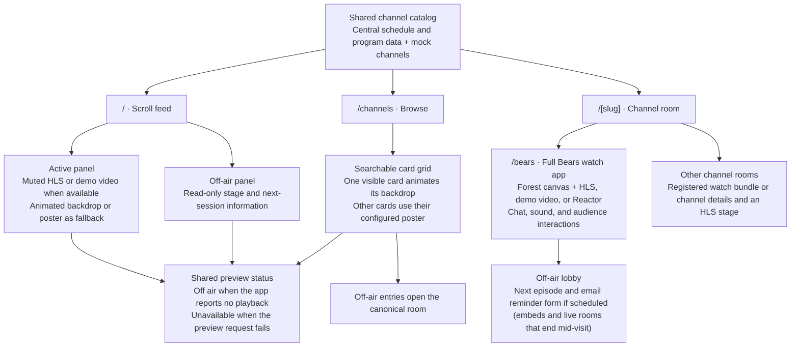

# Channel content by page

## What renders where

| Page | Media and controls |
| --- | --- |
| `/` | Only the active panel mounts the read-only preview, plays media or polls public chat. The preview uses the program's stage and schedule and shows up to three public messages by default. It never offers a composer. |
| `/channels` | The browse grid uses posters and one visible backdrop without starting a player. Program cards always open the canonical room. |
| `/[slug]` | The watch bundle owns the stage and off-air lobby before, during and after the show. Unbundled catalog entries use the Channels stage when a stream is available. |
| `/embed/[slug]?variant=preview` | The same preview contract as the feed, with an explicit partner frame allowlist. |
| `/g/[code]` and `/embed/g/[code]` | The stage follows tuning without replacing the chat window. The public player never reads membership or private chat. |

## App previews and playback

[Register a channel app](./CHANNEL-APPS.md) to give another channel the same room and preview integration.

- The catalog merges central schedule bindings and mock channels by slug. Bears contributes a preview endpoint, poster, and backdrop module when its backend is configured. [Catalog implementation](../lib/catalog.ts)
- An active Bears preview refreshes every 15 seconds through `/api/channels/bears/preview`. The endpoint uses Bears’ `/api/channel` response to resolve playback and the next start time. The browser loads playable media from the returned URL. [Preview implementation](../components/channels/ChannelPreview.tsx)
- Dry run supplies a progressive demo video even between episodes. A Reactor-only channel can be live while its feed panel shows the backdrop. Reactor playback is available inside the room.
- A successful response with no playback marks the channel off-air: the feed panel mounts the program room — the app's own off-air stage — instead of a preview, and `/bears` hands off to that panel. A failed preview request shows “Bears is unavailable right now” and still lets the room mount. The reminder form appears in the Bears room when an upcoming episode is available, and behind every Follow button through the reminders prompt.
- The backdrop entry reuses the Bears forest renderer and scene clock. Channels mounts it independently of the watch bundle, so previewing a card opens no chat, interaction, or Reactor sessions. [Bears integration](./BEARS.md)

## Follows and reminders

Every Follow button — feed panels, the featured banner, channel details, and the room rail — reads one shared client store, so follow state is consistent everywhere a program appears. [Store implementation](../lib/follows.ts)

- Signed-in viewers persist follows to central `program_follows` through `/api/follows`. The store hydrates from the server once and broadcasts updates to all mounted buttons. Writes commit only after the server confirms — a pending, failed, or superseded request never moves a button to "Following" — and a hydration whose snapshot predates a confirmed write is discarded for a fresh one. Writes for the same program serialize, so the last click is the state that sticks.
- Guests follow anonymously: state persists in `localStorage` (`channels:follows`) with no sign-in prompt. On the next authenticated load the store POSTs each stored program to `/api/follows` and removes it locally after success or a permanent rejection (for example a deleted program), so retryable failures transfer on the following visit and dead entries do not linger.
- Clicking Follow opens the reminders form that completes the process — nothing is written until it is submitted, and closing without submitting cancels the follow so the button stays unfollowed. `POST /api/notifications/subscriptions` with `ensureFollow` writes the follow row and the reminder preference in one transaction for verified recipients. Guests submit an email; their follow persists locally and reminders activate through the verification link. Signed-in viewers whose address still needs verifying commit nothing until `claimVerifiedEmail` writes the subscription and `program_follows` together; `claimVerifiedEmail` also associates the recipient with their account when they sign up.
- Channels without a bound `programId` — the static catalog entries — render no Follow button at all; both write routes also 404 on program ids missing from `programs`, so a stand-in can never collect a follow row.
