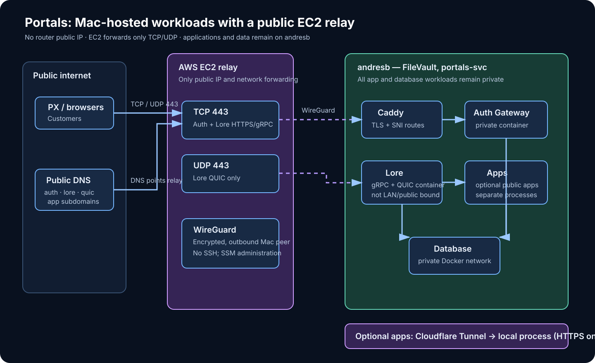

# EC2 network relay

This Pulumi project creates a **network-only** public EC2 relay for the
Mac-hosted deployment. It is intentionally separate from the legacy ECS stack:
it creates no containers, databases, load balancers, S3 buckets, or application
IAM credentials.



## What it creates

- one VPC, public subnet, internet gateway, and route table;
- one encrypted 8 GiB `t3.micro` EC2 instance with a stable Elastic IP;
- a WireGuard endpoint; `andresb` is the only configured peer;
- `nftables` forwarding of public TCP `443` to `andresb:8443` and public UDP
  `443` to `andresb:41337` through the tunnel;
- an SSM-only instance role. There is no inbound SSH rule.

The relay performs no TLS termination. Caddy on `andresb` retains the wildcard
certificate and uses SNI to route `auth.portals.works` and
`lore.portals.works`. Lore receives QUIC on
`quic.lore.portals.works:443`.

PostgreSQL forwarding is disabled unless `postgresAllowedCidrs` is explicitly
set. When set, only those client CIDRs receive TCP `5432`; the relay forwards
that traffic to `andresb:5432` over WireGuard. This release deliberately uses
the reviewed exception `0.0.0.0/0`: PostgreSQL itself requires TLS 1.3, a
private client certificate, and a SCRAM password. Replace it with stable
caller CIDRs when the application platform provides them.

## Costs and boundaries

This is AWS EC2, so it is **not a cost guarantee**. AWS charges an in-use
public IPv4 address at $0.005/hour (about $3.65 at 730 hours) before EC2, EBS,
and data-transfer charges. Run `pulumi preview --diff`, check the AWS pricing
and billing dashboard, and configure an AWS Budget before applying. The module
has no application or database workload; those stay on `andresb`.

If strict zero cash cost is mandatory, provision the equivalent relay on an
available Always Free provider instead. The network topology stays the same.

## Provision

From this directory, with an AWS deployment identity already configured:

```sh
pulumi stack init prod
pulumi config set aws:region us-east-1
pulumi config set wireGuardMacPublicKey "$(cat /path/to/andresb-wg.pub)"
pulumi config set wireGuardServerPublicKey "$(cat /secure/relay-wg.pub)"
pulumi config set --secret wireGuardServerPrivateKey "$(cat /secure/relay-wg.key)"
pulumi preview --diff
pulumi up
```

Generate the relay pair once in a secure local terminal, then store its private
key in an off-repository secret vault:

```sh
umask 077
wg genkey | tee /secure/relay-wg.key | wg pubkey > /secure/relay-wg.pub
```

Generate the `andresb` pair on `andresb`; only its `.pub` file belongs in
Pulumi configuration. Store both private keys outside this repository. The
Pulumi state is sensitive infrastructure state; protect it accordingly.

## Mac-side completion

After the relay applies, configure `andresb` as WireGuard peer `10.77.0.2` with
`PersistentKeepalive = 25`, endpoint `pulumi stack output wireGuardEndpoint`,
and public key `pulumi stack output wireGuardServerPublicKeyOutput`. Then bind
only the WireGuard interface to the existing local ingress:

```text
10.77.0.2:8443 -> Caddy :443
10.77.0.2:41337/udp -> Lore :41337/udp
```

Do not bind those mappings to `0.0.0.0` or the LAN address. Validate private
tunnel reachability before creating DNS records.

macOS needs a direct WireGuard client (for example, the official WireGuard
application) to activate this independent peer configuration. Tailscale cannot
import or use an arbitrary external WireGuard peer configuration.

Create DNS-only `A` records for `auth.portals.works`, `lore.portals.works`, and
`quic.lore.portals.works` to `pulumi stack output publicIp`. Keep app subdomains
on the existing Cloudflare Tunnel if they are public; Cloudflare Tunnel does
not carry public UDP or public-hostname gRPC.

## Acceptance

Before changing canonical DNS, prove from an external non-VPN client:

1. TLS verification and Auth JWKS on TCP 443.
2. Auth gRPC and Lore gRPC through their canonical hostnames.
3. Lore QUIC at `quic.lore.portals.works:443`.
4. PX login, repository access, and cross-repository denial.
5. Relay loss and WireGuard reconnect recovery.

Rollback is a DNS rollback to the prior edge; do not roll back databases or
certificates as part of a network rollback.
